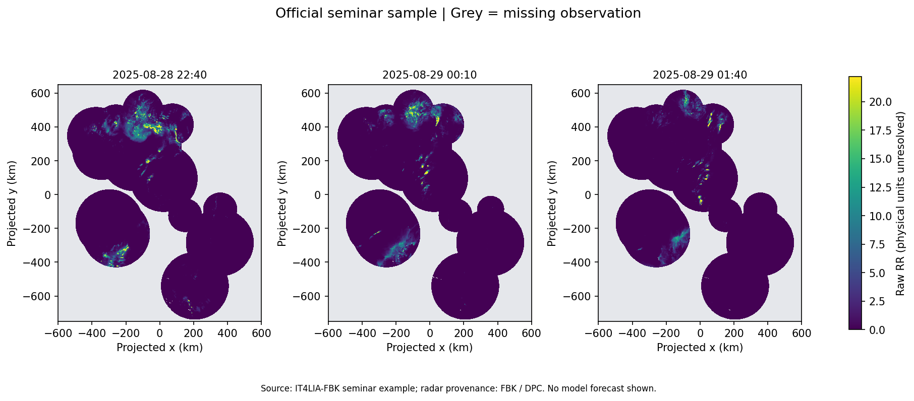
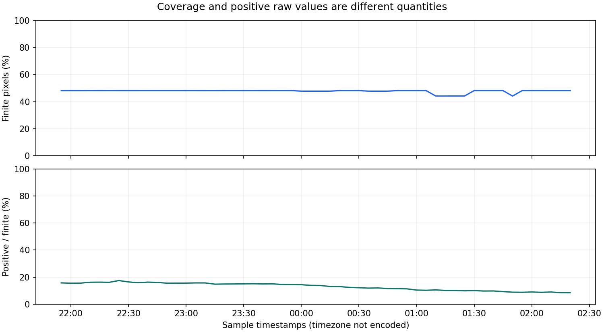

# Radar Nowcasting Lab

A learning and reproduction companion to the [IT4LIA–FBK seminar](https://github.com/DSIP-FBK/IT4LIA-FBK-Seminar), delivered through CINECA training. This repository starts with an audit of the upstream local radar sample and will later explore IRENE inference and forecast evaluation.

## Current status

- Completed: executable local-sample audit, timestamp checks, missing-value statistics and plots.
- Identified: the sample's unit metadata differs from the units described in the course/model documentation. Physical-unit interpretation remains unresolved.
- Planned: resolve units, run the pretrained IRENE model, compare forecasts with persistence, and evaluate independent precipitation events.
- No model training or model-performance improvement is claimed in this version.

## First result

The sample contains 54 time steps on a 1400 × 1200 grid, separated by 5 minutes. Its compact NetCDF file expands to approximately 363 MB of float32 radar values. Missing observations must remain distinguishable from dry pixels.





The plots deliberately use **raw RR values with unverified physical units**. Projected x/y axes are in kilometres; these plots do not reconstruct a geographic CRS. See [the first learning note](docs/learning-note-01.md) and [the audit summary](reports/sample_audit.json).

## Reproduce the sample audit

This lightweight notebook does not need a GPU, model weights, or an ArcoDataHub account. It reads the existing example file from the official repository. Python 3.12 is the tested interpreter for this companion, independently of the two upstream module environments.

Clone the official repository into a folder next to this project:

```bash
git clone https://github.com/DSIP-FBK/IT4LIA-FBK-Seminar.git ../IT4LIA-FBK-Seminar
git -C ../IT4LIA-FBK-Seminar checkout 676ffe7f941511bbdd955cfe9ec8bf51d05aad0e
python -m venv .venv
```

Activate `.venv` using your platform's normal command, then:

```bash
python -m pip install -r requirements.txt
python scripts/run_notebook.py --source-repo ../IT4LIA-FBK-Seminar
```

Run these commands from this repository root. Alternatively open `notebooks/01_local_sample_audit.ipynb` in VS Code and select the same environment. The original official notebooks are not replaced by this companion.

## Learning sequence

| Step | Official material | Evidence to add here |
| --- | --- | --- |
| 1 | Module 1: dataset structure | Local audit, units, missingness, time and coordinate notes |
| 2 | Module 1: Zarr format | A measured chunk-access experiment; record data size, caching and runtime |
| 3 | Module 2: PyTorch introduction | Explain model inputs/outputs and preprocessing |
| 4 | Module 2: live IRENE inference | A small real-data inference example with settings and limitations |
| 5 | Own evaluation | Persistence comparison, masks, lead-time errors and failure cases |

For upstream cloud notebooks, follow the upstream README: each module has its own `uv` environment. Module 2 currently declares Python ≥3.13. ArcoDataHub credentials are needed for the cloud data workflow. Keep credentials local; do not include authenticated URLs or notebook outputs containing them in commits.

## Sources and attribution

- [Official course repository](https://github.com/DSIP-FBK/IT4LIA-FBK-Seminar), reviewed at commit `676ffe7f941511bbdd955cfe9ec8bf51d05aad0e`.
- [CINECA course page](https://learn.cineca.it/course/view.php?id=2243), login required.
- [IRENE model card](https://huggingface.co/it4lia/irene).

Original seminar code, slides, notebooks, example data and pretrained weights belong to their respective authors; they are not redistributed in this companion. The upstream Module 2 has a BSD-2-Clause licence; do not assume that this automatically licenses every other course asset. Course Module 1 identifies the radar dataset as CC BY-SA 4.0. Derived radar figures here credit FBK/DPC, reference the upstream sample, and are provided under CC BY-SA 4.0. Preserve provenance when reusing them.

